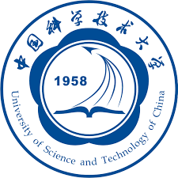
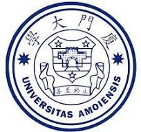

## Education

  
  

    
University of Science and Technology of China &amp; Shanghai AI Lab

    
Ph.D. candidate, Information and Communication Engineering

    
Hefei &amp; Shanghai · July 2024 – June 2027 (expected)

  

<ul class="edu-details">
  <li>Advisors: <a href="https://scholar.google.com/citations?user=5bInRDEAAAAJ&hl=en">Feng Wu</a> and <a href="https://scholar.google.com/citations?user=Snl0HPEAAAAJ&hl=en&oi=ao">Zhiwei Xiong</a>; connectomics and neuroscience mentor: <a href="https://ibi.braintell.org/#/cn/faculty/zhang-ruobing">Ruobing Zhang</a>.</li>
  <li>Principal Investigator, <a href="/docs/国自然.png">NSFC Doctoral Student Project</a> (awarded in 2024; project period 2025–2027).</li>
  <li>Selected for the <a href="/docs/cast_ccf_2026_selection_proof.png?v=20261022">2026 CAST Doctoral Student Program</a>, with the China Computer Federation (CCF) as the cultivating society.</li>
</ul>

  
  

    
University of Science and Technology of China

    
M.S. in Computer Technology

    
Hefei · September 2022 – July 2024

  

<ul class="edu-details">
  <li><a href="/docs/国奖证书研究生.png">National Graduate Scholarship</a>, 2022.</li>
</ul>

  
  

    
Xiamen University

    
Dual bachelor's degrees in Environmental Ecological Engineering and Economics

    
Xiamen · September 2018 – July 2022

  

<ul class="edu-details">
  <li>Research advisor: <a href="https://scholar.google.com/citations?user=l1GMXf4AAAAJ&hl=en&oi=ao">Yuanye Zhang</a>.</li>
  <li><a href="/docs/学术之星奖杯.jpg">Xiamen University Academic Star</a>, 2021; CDA Level 1 certification, 2022; <a href="https://www.kaggle.com/yindachen">Kaggle Expert</a>.</li>
</ul>

