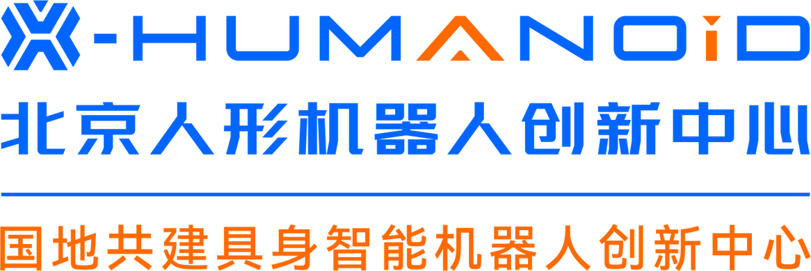
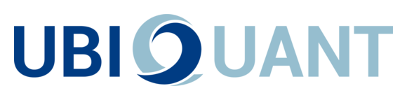
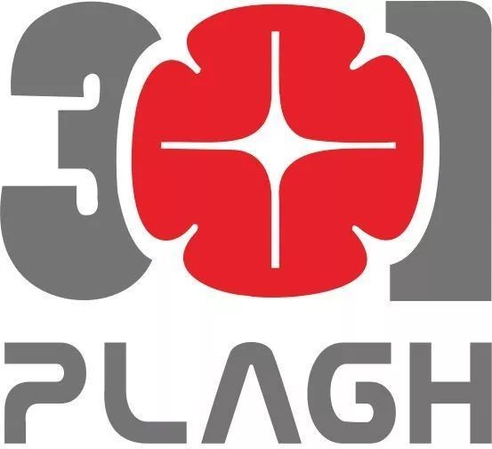
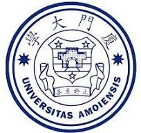

# 💼 Professional Experience

🏢 Industry Experience 4

  
  

    
<a href="https://www.x-humanoid.com/">Beijing Innovation Center of Humanoid Robotics (X-Humanoid)</a>

    
Core Member, Embodied Intelligence World Model Team

    
📍 Beijing · Dec 2025 - Present

  

<ul class="exp-details">
  <li>Developing unified embodied models that connect scene and instruction understanding, future prediction, and robot action.</li>
  <li>Core contributor to <a href="https://arxiv.org/abs/2605.15153">Pelican-Unified 1.0</a>, focusing on unified vision-language modeling and action capability.</li>
  <li>Contributed to <a href="https://arxiv.org/abs/2607.06655">Pelican-VLA 0.5</a>, studying bottleneck representations for task-relevant perception and manipulation across scenes and embodiments.</li>
</ul>

  
  

    
<a href="https://www.ubiquant.com/">Ubiquant (九坤投资)</a>

    
Research Intern, Quantitative Research and Foundation Models

    
📍 Beijing · May 2026 - Oct 2026

  

<ul class="exp-details">
  <li>Worked on quantitative research and language models for factor mining and data-driven decisions, with experience in thousand-GPU-scale training.</li>
  <li>Contributor and co-author of <a href="https://arxiv.org/abs/2610.30949" title="Q1: Advancing Foundation Capabilities for Agentic CLI Systems">Q1</a>, an agentic foundation model for CLI interaction, coding, and multi-step tool use (October 2026 technical report).</li>
  <li>Core contributor to <a href="https://arxiv.org/abs/2610.11451" title="SAIL: Scientific Agentic Intelligence via a Science-Aware Loop">SAIL</a>, a scientific-agent model for literature research, scientific coding, and multi-step research workflows (October 2026).</li>
</ul>

  
  

    
<a href="https://ieg.tencent.com/">Tencent Interactive Entertainment Group (IEG)</a>

    
Qingyun Program Intern

    
📍 Shanghai · Aug 2025 - Dec 2025

  

<ul class="exp-details">
  <li>Developed multimodal scene understanding and game world models for gameplay analysis and content generation.</li>
  <li>Worked on <em>Honor of Kings – Lingbao</em>, including text-to-speech and live match commentary, with <a href="https://scholar.google.com/citations?user=oxNIbCUAAAAJ&hl=en&oi=ao">Dr. Liang Du</a> and <a href="https://scholar.google.com/citations?hl=en&user=ibNed18AAAAJ">Dr. Wentao Yao</a>.</li>
  <li>Contributed to <a href="https://main-vla.github.io/">MAIN-VLA</a>, a world model for <em>Game for Peace (和平精英)</em> that connects intentions, game states, and actions.</li>
  <li>Researched router-free MoE-LoRA adaptation through linear aggregation and merging of low-rank expert updates.</li>
</ul>

  
  

    
<a href="/docs/301医院.png">PLA General Hospital (301 Hospital)</a>

    
Research Intern, Data Compression Group

    
📍 Beijing · Sept 2023 - Feb 2024

  

<ul class="exp-details">
  <li>Collaborated with <a href="https://scholar.google.com/citations?user=CHAajY4AAAAJ&hl=en&oi=ao">Prof. Qionghai Dai</a>'s team on medical image compression, designing methods adapted to different imaging modalities.</li>
</ul>

🎓 Academic Experience 3

  
  

    
<a href="/docs/IC_letter_Yinda.png">Imperial College London</a>

    
Research Intern, Data Science Institute

    
📍 London (remote) · Nov 2022 - Aug 2023

  

<ul class="exp-details">
  <li>Worked with <a href="https://scholar.google.com/citations?user=oxy2ZQoAAAAJ&hl=en">Dr. Rossella Arcucci</a> and <a href="https://scholar.google.com/citations?user=HED_458AAAAJ&hl=en&oi=sra">Dr. Che Liu</a> on multimodal pretraining and image-text contrastive learning for medical images.</li>
  <li>This collaboration led to work including GTGM and BIMCV-R; see <a href="#-publications">selected publications</a>.</li>
</ul>

  
  

    
<a href="/docs/wiserclub.png">Xiamen University WISER Club</a>

    
Academic Community Member, Data Mining Group

    
📍 Xiamen · Aug 2021 - July 2022

  

<ul class="exp-details">
  <li>Designed and delivered data mining courses on clustering and Transformers, and mentored undergraduate machine learning projects. <a href="https://mp.weixin.qq.com/s/sqF3p69kdTF8KmdRhfEEMw">Campus feature</a>.</li>
</ul>

  
  

    
<a href="/docs/wise研助.png">Wang Yanan Institute for Studies in Economics, Xiamen University</a>

    
Research Assistant, Econometrics

    
📍 Xiamen · Aug 2020 - Dec 2021

  

<ul class="exp-details">
  <li>Assisted Jiong Zhu with land economic statistics research, using satellite imagery and visual features to study homesteads and land-use change.</li>
</ul>

