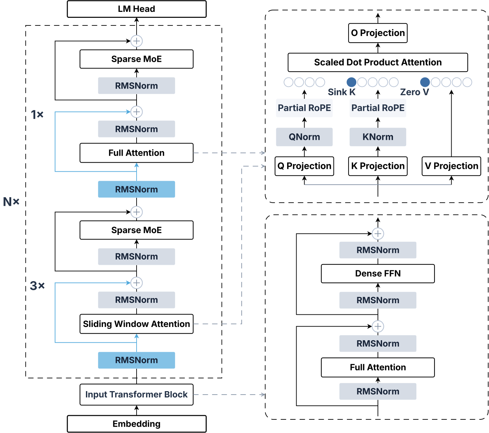
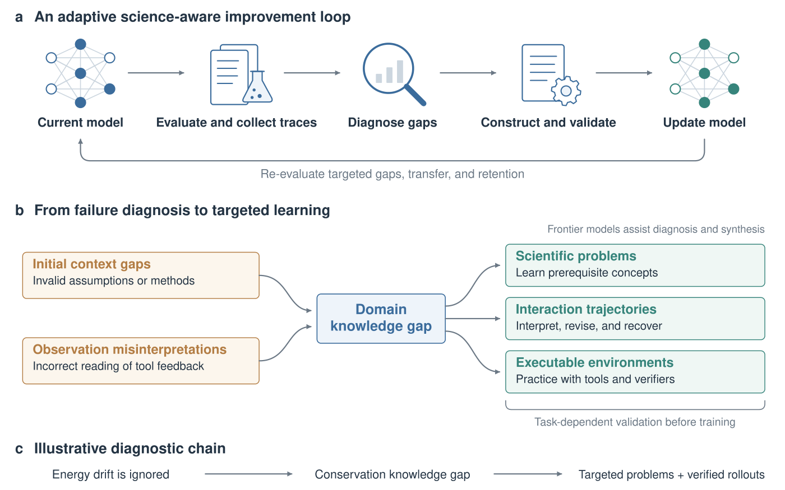

# 📝 Selected Research

For a complete list of publications, please visit my [Google Scholar profile](https://scholar.google.com/citations?user=hCvlj5cAAAAJ&hl=en&oi=ao) 

📈 <strong>View Citation Trend</strong>

  

**Note:** * denotes equal contribution. Individual roles are stated where applicable.

🧠 Representation and Predictive Learning 4

ICCV 2025

CCF A

[TokenUnify: Scaling Up Autoregressive Pretraining for Neuron Segmentation](https://openaccess.thecvf.com/content/ICCV2025/html/Chen_TokenUnify_Scaling_Up_Autoregressive_Pretraining_for_Neuron_Segmentation_ICCV_2025_paper.html)  Computer VisionSelf-Supervised Learning \\
ICCV · 2025 \\
**Yinda Chen**\*; Haoyuan Shi\*; Xiaoyu Liu; Te Shi; Ruobing Zhang; Dong Liu; Zhiwei Xiong; Feng Wu

[**Code**](https://github.com/ydchen0806/TokenUnify)  | [**Dataset**](https://huggingface.co/datasets/cyd0806/wafer_EM) | [**Weights**](https://huggingface.co/cyd0806/TokenUnify/tree/main/Pretrained_weights)

Autoregressive pretraining for volumetric neuron segmentation, combining three complementary prediction objectives with long-sequence modeling and an analysis of prediction-error accumulation.

ICML 2025

CCF A

[MaskTwins: Dual-form Complementary Masking for Domain-Adaptive Image Segmentation](https://proceedings.mlr.press/v267/wang25n.html)  Domain AdaptationPretraining Methods \\
ICML · 2025 \\
Jiawen Wang; **Yinda Chen**; Xiaoyu Liu; Che Liu; Dong Liu; Jianqing Gao; Zhiwei Xiong

[**Code**](https://github.com/jwwang0421/masktwins)  | [**Poster**](https://icml.cc/media/PosterPDFs/ICML%202025/46243.png?t=1750997391.8351207)

My contribution: theoretical analysis.

Complementary spatial and feature masking for domain-adaptive segmentation, evaluated on urban-scene and electron microscopy benchmarks.

IJCAI 2023

CCF A

[Self-Supervised Neuron Segmentation with Multi-Agent Reinforcement Learning](https://www.ijcai.org/proceedings/2023/68)  Computer VisionSelf-Supervised Learning \\
IJCAI · 2023 \\
**Yinda Chen**; Wei Huang; Shenglong Zhou; Qi Chen; Zhiwei Xiong

[**Code**](https://github.com/ydchen0806/dbMiM)  | [**Pretraining data**](https://huggingface.co/datasets/cyd0806/EM_pretrain_data)

Decision-based masked image modeling that learns masking policies through multi-agent reinforcement learning for neuron segmentation.

ICASSP 2024

CCF B

[Learning Multiscale Consistency for Self-Supervised Electron Microscopy Instance Segmentation](https://arxiv.org/abs/2308.09917)  Computer VisionPretraining Methods \\
ICASSP · 2024 \\
**Yinda Chen**; Wei Huang; Xiaoyu Liu; Shiyu Deng; Qi Chen; Zhiwei Xiong

[**Code**](https://github.com/ydchen0806/MS-Con-EM-Seg) 

Self-supervised pretraining that encourages multiscale consistency in volumetric electron microscopy representations for neuron instance segmentation.

✨ Multimodal and Generative Models 9

IEEE TPAMI

[Learned Image Coding with Generative Reference of Conditional Latents](https://doi.org/10.1109/TPAMI.2026.3744812)  Image CompressionGenerative Models \\
IEEE TPAMI · Accepted October 2026 \\
Siqi Wu\*; **Yinda Chen**\*; Weiming Chen; Dong Liu; K. C. Ho; Zhihai He

[**PDF**](/docs/Learned_Image_Coding_with_Generative_Reference_of_Conditional_Latents.pdf) | [**Code**](https://github.com/ydchen0806/CLC) 

GRCL uses retrieved or generated images as references for conditional latent coding. The framework combines reference generation, latent matching and synthesis, and theoretical analysis of robustness to reference perturbations.

IEEE TCSVT

[Joint Semantic and Coded Generation for Conditional Latent Coding](https://doi.org/10.1109/TCSVT.2026.3702531)  Image CompressionGenerative Models \\
IEEE TCSVT · 2026 \\
Siqi Wu; Weiming Chen; **Yinda Chen**; Dong Liu; K. C. Ho; Zhihai He

[**Paper**](https://ieeexplore.ieee.org/document/11557391/)

Collaborative work on jointly using semantic information and coded representations to generate references for conditional latent image compression.

IEEE Internet of Things Journal

[FURINA: Free from Unmergeable Router via LINear Aggregation of mixed experts](https://arxiv.org/abs/2509.14900)  Mixture of ExpertsEfficient Adaptation \\
IEEE Internet of Things Journal · Accepted 2026 \\
Jiayi Han et al. (including **Yinda Chen**)

[**Preprint**](https://arxiv.org/abs/2509.14900)

Router-free mixture-of-experts adaptation with LoRA. The expert updates can be merged into the base model, avoiding an additional routing structure at inference.

AAAI 2025

CCF A

[Conditional Latent Coding with Learnable Synthesized Reference for Deep Image Compression](https://doi.org/10.1609/aaai.v39i12.33403)  Image Compression \\
AAAI · 2025 \\
Siqi Wu\*; **Yinda Chen**\*; Dong Liu; Zhihai He

[**PDF**](/docs/Condition_generation_Latent_Coding_with_an_External_Dictionary_for_Deep_Image_Compression.pdf) | [**Code**](https://github.com/ydchen0806/CLC)  | [**Weights**](https://huggingface.co/cyd0806/CLC)

Learnable reference synthesis from an external image dictionary improves conditional latent coding for learned image compression.

ICCV Workshop 2025

[GTGM: Generative Text-Guided 3D Vision-Language Pretraining for Medical Image Segmentation](https://openaccess.thecvf.com/content/ICCV2025W/VLM3D/html/Chen_GTGM_Generative_Text-Guided_3D_Vision-Language_Pretraining_for_Medical_Image_Segmentation_ICCVW_2025_paper.html)  Vision-LanguageMedical Imaging \\
ICCV Workshop on VLM3D · 2025 \\
**Yinda Chen**\*; Che Liu\*; Wei Huang; Xiaoyu Liu; Haoyuan Shi; Sibo Cheng; Rossella Arcucci; Zhiwei Xiong

[**Code**](https://github.com/ydchen0806/gtgm) 

Uses generated textual descriptions and negative-free contrastive learning to pretrain 3D medical image representations without paired medical text; evaluated through downstream segmentation on 10 CT/MRI datasets.

MICCAI 2024

CCF B

[BIMCV-R: A Landmark Dataset for 3D CT Text-Image Retrieval](https://papers.miccai.org/miccai-2024/100-Paper1194.html)  Vision-LanguageMultimodal Learning \\
MICCAI · 2024 \\
**Yinda Chen**; Che Liu; Xiaoyu Liu; Rossella Arcucci; Zhiwei Xiong

[**Dataset**](https://huggingface.co/datasets/cyd0806/BIMCV-R) | [**Code**](https://github.com/ydchen0806/MedFinder) 

A dataset of 8,069 3D CT volumes with paired radiology reports, together with the MedFinder framework for bidirectional medical image–text retrieval.

NeurIPS 2024

CCF A

[MaskFactory: Towards High-quality Synthetic Data Generation for Dichotomous Image Segmentation](https://arxiv.org/abs/2412.19080)  Multimodal Learning \\
NeurIPS · 2024 \\
Haotian Qian\*; **Yinda Chen**\*; Shengtao Lou; Fahad Shahbaz Khan; Xiaogang Jin; Deng-Ping Fan

[**Project**](https://qian-hao-tian.github.io/MaskFactory/) | [**Code**](https://github.com/ydchen0806/MaskFactory) 

A two-stage framework for generating paired images and masks for dichotomous image segmentation, expanding training data while preserving image–mask consistency.

IEEE TMI

[Unsupervised Domain Adaptation for EM Image Denoising with Invertible Networks](/docs/Unsupervised_Domain_Adaptation_for_EM_Image_Denoising_With_Invertible_Networks.pdf)  Domain AdaptationImage Denoising \\
IEEE TMI · 2024 \\
Shiyu Deng; **Yinda Chen**; Wei Huang; Ruobing Zhang; Zhiwei Xiong

[**Code**](https://github.com/sydeng99/DADn) 

Invertible networks for unsupervised adaptation of electron microscopy denoising across imaging domains.

IEEE JBHI

[EMPOWER: Evolutionary Medical Prompt Optimization With Reinforcement Learning](https://doi.org/10.1109/JBHI.2025.3621907)  Vision-LanguageMultimodal Learning \\
IEEE JBHI · 2025 \\
**Yinda Chen**\*; Yangfan He\*; Jing Yang; Dapeng Zhang; Zhenlong Yuan; Muhammad Attique Khan; Jamel Baili; Por Lip Yee

[**Paper**](https://ieeexplore.ieee.org/document/11205280/)

Combines evolutionary prompt optimization with reinforcement learning and multi-dimensional evaluation for medical language tasks.

🛠️ Agentic Foundation Models &amp; Scientific Agents 2

<!-- Original report figure: https://arxiv.org/html/2610.30949v1/M1-ARCH-V3.svg -->

Technical Report 2026

[IQuest-Q1: Advancing Foundation Capabilities for Agentic CLI Systems](https://arxiv.org/abs/2610.30949)  Agentic ModelsTool Use \\
IQuest Research · October 2026 \\
IQuest-Q1 Team · **Yinda Chen**, co-author

[**Report**](https://arxiv.org/abs/2610.30949) | [**Project**](https://iquestlab.github.io/) | [**Code**](https://github.com/IQuestLab/IQuest-Q1)  | [**Models**](https://huggingface.co/IQuestLab/IQuest-Q1)

A foundation model for command-line interaction, coding, and multi-step tool use. Contributed during my research internship at Ubiquant / IQuest Research.

<!-- Original report figure: https://arxiv.org/html/2610.11451v1/improvement-loop.svg -->

Technical Report 2026

[SAIL: Scientific Agentic Intelligence via a Science-Aware Loop](https://arxiv.org/abs/2610.11451)  Scientific AgentsAgentic Models \\
Ubiquant / IQuest Research · October 2026 \\
SAIL Model Team · **Yinda Chen**, core contributor

[**Report**](https://arxiv.org/abs/2610.11451)

A scientific-agent research project for literature research, scientific coding, and multi-step investigations, developed through a science-aware improvement loop.

🤖 World Models and Embodied Intelligence 2

Technical Report 2026

[Pelican-Unified 1.0: A Unified Embodied Intelligence Model (UEI) for Understanding, Reasoning, Imagination and Action](https://arxiv.org/abs/2605.15153)  Embodied IntelligenceWorld ModelsUnified Models \\
X-Humanoid, WFM System Group · May 2026 \\
Pelican-Unified Team · **Yinda Chen**, core contributor

[**Report**](https://arxiv.org/abs/2605.15153) | [**Organization**](https://www.x-humanoid.com/)

My contribution: unified vision-language modeling and action capability.

A unified embodied model that combines scene and instruction understanding, task reasoning, and joint prediction of future video and robot actions.

Technical Report 2026

[Pelican-VLA 0.5: Attending Before Acting Benefits Generalization](https://arxiv.org/abs/2607.06655)  Vision-Language-ActionEmbodied IntelligenceWorld Models \\
X-Humanoid, WFM System Group · July 2026 \\
Pelican-VLA Team · **Yinda Chen**, contributor

[**Report**](https://arxiv.org/abs/2607.06655) | [**Code**](https://github.com/Open-X-Humanoid/Pelican-VLA05)  | [**Models**](https://huggingface.co/X-Humanoid/Pelican-VLA05)

The VLA component of Pelican-Unified connects vision-language understanding, future-frame generation, and action prediction through learnable bottleneck tokens. The work studies task-relevant attention and manipulation generalization.

