## Selected research

Selected journal and conference papers, followed by technical reports. **Yinda Chen** is highlighted in each author list; \* denotes equal contribution where indicated.
For the complete publication record, see [Google Scholar](https://scholar.google.com/citations?user=hCvlj5cAAAAJ&hl=en).

Citation history

  <a href="https://scholar.google.com/citations?user=hCvlj5cAAAAJ&hl=en">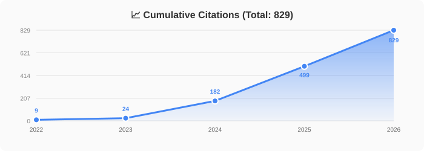</a>

Representation and generative learning 7 papers

<article class="paper-box">

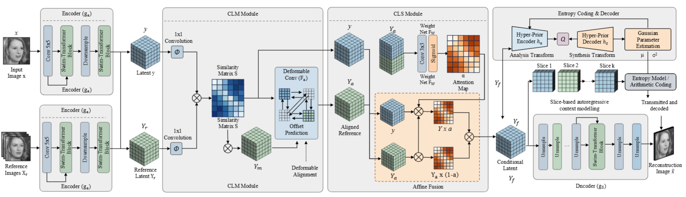

IEEE TPAMI · Accepted October 2026

<h3><a href="https://doi.org/10.1109/TPAMI.2026.3744812">Learned Image Coding with Generative Reference of Conditional Latents</a></h3>

Siqi Wu*; <strong>Yinda Chen*</strong>; Weiming Chen; Dong Liu; K. C. Ho; Zhihai He

GRCL uses retrieved or generated images as references for conditional latent coding. The framework combines reference generation, latent matching and synthesis, and theoretical analysis of robustness to reference perturbations.

<a href="/docs/Learned_Image_Coding_with_Generative_Reference_of_Conditional_Latents.pdf">PDF</a><a href="https://github.com/ydchen0806/CLC">Code</a>

</article>

<article class="paper-box paper-text-only">

IEEE Internet of Things Journal · Accepted 2026

<h3><a href="https://arxiv.org/abs/2509.14900">FURINA: Free from Unmergeable Router via LINear Aggregation of mixed experts</a></h3>

Jiayi Han et al. (including <strong>Yinda Chen</strong>)

Router-free mixture-of-experts adaptation with LoRA. The expert updates can be merged into the base model, avoiding an additional routing structure at inference.

<a href="https://arxiv.org/abs/2509.14900">Preprint</a>

</article>

<article class="paper-box paper-text-only">

IEEE TCSVT · 2026

<h3><a href="https://doi.org/10.1109/TCSVT.2026.3702531">Joint Semantic and Coded Generation for Conditional Latent Coding</a></h3>

Siqi Wu; Weiming Chen; <strong>Yinda Chen</strong>; Dong Liu; K. C. Ho; Zhihai He

Collaborative work on jointly using semantic information and coded representations to generate references for conditional latent image compression.

<a href="https://ieeexplore.ieee.org/document/11557391/">Paper</a>

</article>

<article class="paper-box">

ICCV · 2025

<h3><a href="https://openaccess.thecvf.com/content/ICCV2025/html/Chen_TokenUnify_Scaling_Up_Autoregressive_Pretraining_for_Neuron_Segmentation_ICCV_2025_paper.html">TokenUnify: Scaling Up Autoregressive Pretraining for Neuron Segmentation</a></h3>

<strong>Yinda Chen*</strong>; Haoyuan Shi*; Xiaoyu Liu; Te Shi; Ruobing Zhang; Dong Liu; Zhiwei Xiong; Feng Wu

Autoregressive pretraining for volumetric neuron segmentation, combining three complementary prediction objectives with long-sequence modeling and an analysis of prediction-error accumulation.

<a href="https://github.com/ydchen0806/TokenUnify">Code</a><a href="https://huggingface.co/datasets/cyd0806/wafer_EM">Dataset</a><a href="https://huggingface.co/cyd0806/TokenUnify/tree/main/Pretrained_weights">Weights</a>

</article>

<article class="paper-box">

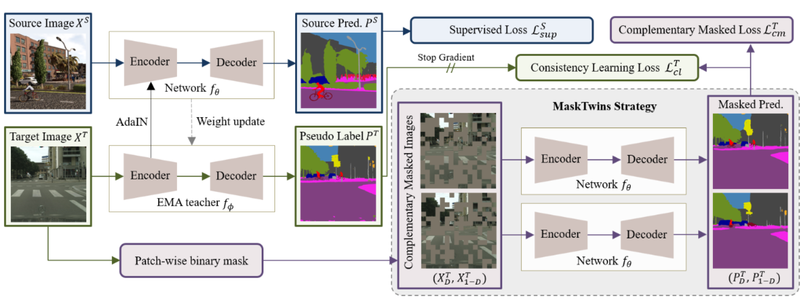

ICML · 2025

<h3><a href="https://proceedings.mlr.press/v267/wang25n.html">MaskTwins: Dual-form Complementary Masking for Domain-Adaptive Image Segmentation</a></h3>

Jiawen Wang; <strong>Yinda Chen</strong>; Xiaoyu Liu; Che Liu; Dong Liu; Jianqing Gao; Zhiwei Xiong

My contribution: theoretical analysis.

Complementary spatial and feature masking for domain-adaptive segmentation, evaluated on urban-scene and electron microscopy benchmarks.

<a href="https://github.com/jwwang0421/masktwins">Code</a><a href="https://icml.cc/media/PosterPDFs/ICML%202025/46243.png?t=1750997391.8351207">Poster</a>

</article>

<article class="paper-box">

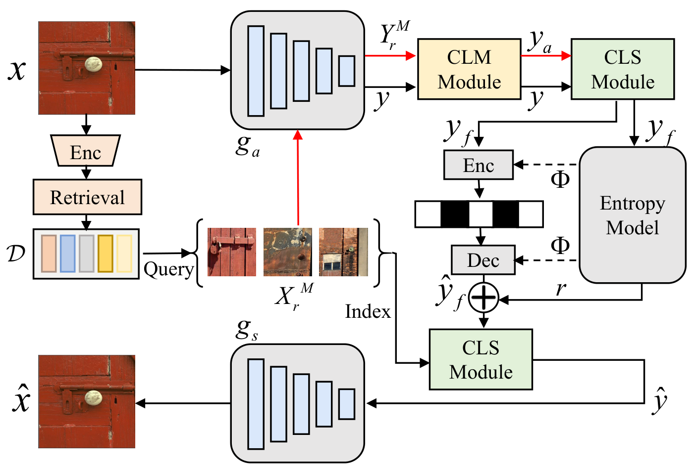

AAAI · 2025

<h3><a href="https://doi.org/10.1609/aaai.v39i12.33403">Conditional Latent Coding with Learnable Synthesized Reference for Deep Image Compression</a></h3>

Siqi Wu*; <strong>Yinda Chen*</strong>; Dong Liu; Zhihai He

Learnable reference synthesis from an external image dictionary improves conditional latent coding for learned image compression.

<a href="/docs/Condition_generation_Latent_Coding_with_an_External_Dictionary_for_Deep_Image_Compression.pdf">PDF</a><a href="https://github.com/ydchen0806/CLC">Code</a><a href="https://huggingface.co/cyd0806/CLC">Weights</a>

</article>

<article class="paper-box">

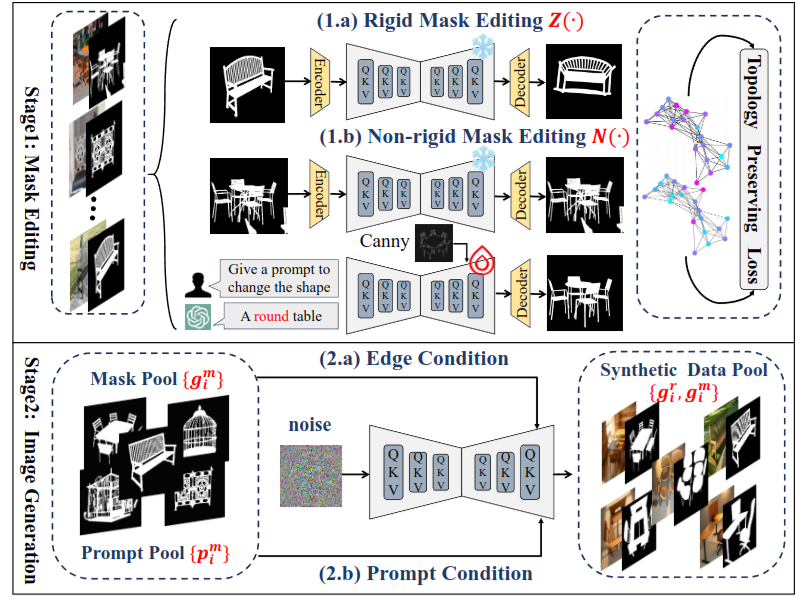

NeurIPS · 2024

<h3><a href="https://arxiv.org/abs/2412.19080">MaskFactory: Towards High-quality Synthetic Data Generation for Dichotomous Image Segmentation</a></h3>

Haotian Qian*; <strong>Yinda Chen*</strong>; Shengtao Lou; Fahad Shahbaz Khan; Xiaogang Jin; Deng-Ping Fan

A two-stage framework for generating paired images and masks for dichotomous image segmentation, expanding training data while preserving image–mask consistency.

<a href="https://qian-hao-tian.github.io/MaskFactory/">Project</a><a href="https://github.com/ydchen0806/MaskFactory">Code</a>

</article>

Biomedical imaging and connectomics 6 papers

<article class="paper-box">

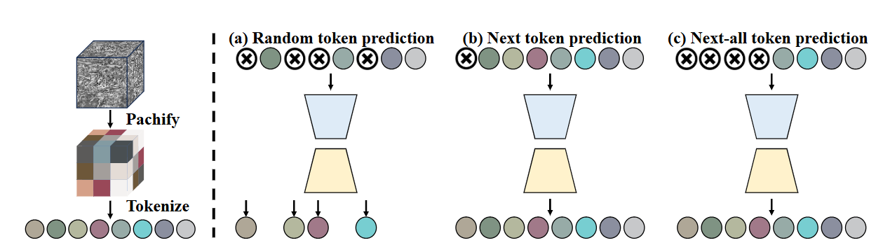

ICCV Workshop on VLM3D · 2025

<h3><a href="https://openaccess.thecvf.com/content/ICCV2025W/VLM3D/html/Chen_GTGM_Generative_Text-Guided_3D_Vision-Language_Pretraining_for_Medical_Image_Segmentation_ICCVW_2025_paper.html">GTGM: Generative Text-Guided 3D Vision-Language Pretraining for Medical Image Segmentation</a></h3>

<strong>Yinda Chen*</strong>; Che Liu*; Wei Huang; Xiaoyu Liu; Haoyuan Shi; Sibo Cheng; Rossella Arcucci; Zhiwei Xiong

Uses generated textual descriptions and negative-free contrastive learning to pretrain 3D medical image representations without paired medical text; evaluated through downstream segmentation on 10 CT/MRI datasets.

<a href="https://github.com/ydchen0806/gtgm">Code</a>

</article>

<article class="paper-box">

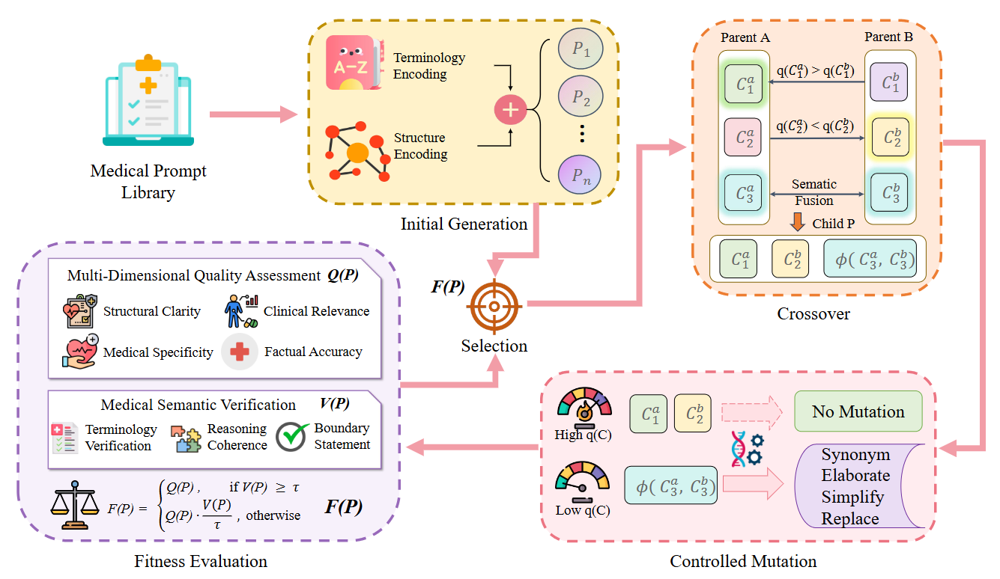

IEEE JBHI · 2025

<h3><a href="https://doi.org/10.1109/JBHI.2025.3621907">EMPOWER: Evolutionary Medical Prompt Optimization With Reinforcement Learning</a></h3>

<strong>Yinda Chen*</strong>; Yangfan He*; Jing Yang; Dapeng Zhang; Zhenlong Yuan; Muhammad Attique Khan; Jamel Baili; Por Lip Yee

Combines evolutionary prompt optimization with reinforcement learning and multi-dimensional evaluation for medical language tasks.

<a href="https://ieeexplore.ieee.org/document/11205280/">Paper</a>

</article>

<article class="paper-box">

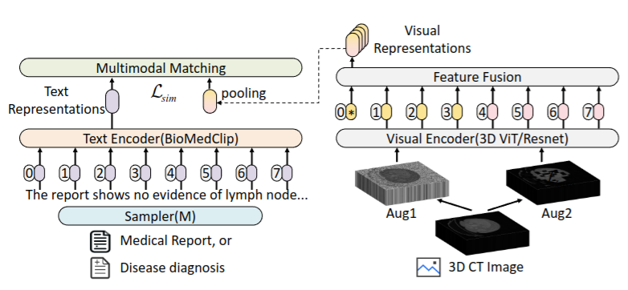

MICCAI · 2024

<h3><a href="https://papers.miccai.org/miccai-2024/100-Paper1194.html">BIMCV-R: A Landmark Dataset for 3D CT Text-Image Retrieval</a></h3>

<strong>Yinda Chen</strong>; Che Liu; Xiaoyu Liu; Rossella Arcucci; Zhiwei Xiong

A dataset of 8,069 3D CT volumes with paired radiology reports, together with the MedFinder framework for bidirectional medical image–text retrieval.

<a href="https://huggingface.co/datasets/cyd0806/BIMCV-R">Dataset</a><a href="https://github.com/ydchen0806/MedFinder">Code</a>

</article>

<article class="paper-box">

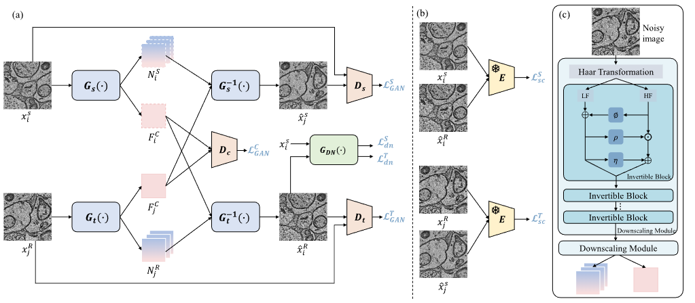

IEEE TMI · 2024

<h3><a href="/docs/Unsupervised_Domain_Adaptation_for_EM_Image_Denoising_With_Invertible_Networks.pdf">Unsupervised Domain Adaptation for EM Image Denoising with Invertible Networks</a></h3>

Shiyu Deng; <strong>Yinda Chen</strong>; Wei Huang; Ruobing Zhang; Zhiwei Xiong

Invertible networks for unsupervised adaptation of electron microscopy denoising across imaging domains.

<a href="https://github.com/sydeng99/DADn">Code</a>

</article>

<article class="paper-box">

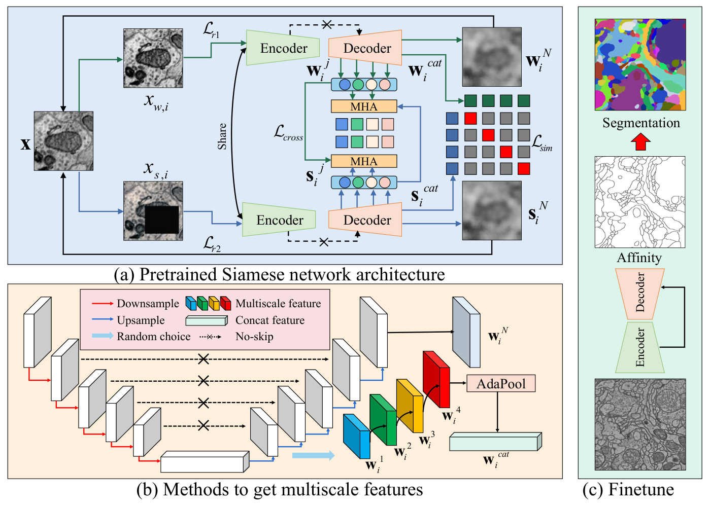

ICASSP · 2024

<h3><a href="https://arxiv.org/abs/2308.09917">Learning Multiscale Consistency for Self-Supervised Electron Microscopy Instance Segmentation</a></h3>

<strong>Yinda Chen</strong>; Wei Huang; Xiaoyu Liu; Shiyu Deng; Qi Chen; Zhiwei Xiong

Self-supervised pretraining that encourages multiscale consistency in volumetric electron microscopy representations for neuron instance segmentation.

<a href="https://github.com/ydchen0806/MS-Con-EM-Seg">Code</a>

</article>

<article class="paper-box">

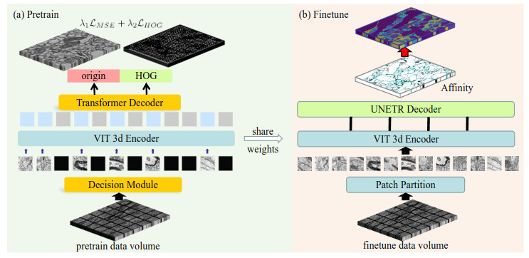

IJCAI · 2023

<h3><a href="https://www.ijcai.org/proceedings/2023/68">Self-Supervised Neuron Segmentation with Multi-Agent Reinforcement Learning</a></h3>

<strong>Yinda Chen</strong>; Wei Huang; Shenglong Zhou; Qi Chen; Zhiwei Xiong

Decision-based masked image modeling that learns masking policies through multi-agent reinforcement learning for neuron segmentation.

<a href="https://github.com/ydchen0806/dbMiM">Code</a><a href="https://huggingface.co/datasets/cyd0806/EM_pretrain_data">Pretraining data</a>

</article>

Embodied and agentic models 4 technical reports

<article class="paper-box paper-text-only">

IQuest Research · October 2026

<h3><a href="https://arxiv.org/abs/2610.30949">IQuest-Q1: Advancing Foundation Capabilities for Agentic CLI Systems</a></h3>

IQuest-Q1 Team · <strong>Yinda Chen</strong>, co-author

A foundation model for command-line interaction, coding, and multi-step tool use. Contributed during my research internship at Ubiquant / IQuest Research.

<a href="https://arxiv.org/abs/2610.30949">Report</a><a href="https://iquestlab.github.io/">Project</a><a href="https://github.com/IQuestLab/IQuest-Q1">Code</a><a href="https://huggingface.co/IQuestLab/IQuest-Q1">Models</a>

</article>

<article class="paper-box paper-text-only">

Ubiquant / IQuest Research · October 2026

<h3><a href="https://arxiv.org/abs/2610.11451">SAIL: Scientific Agentic Intelligence via a Science-Aware Loop</a></h3>

SAIL Model Team · <strong>Yinda Chen</strong>, core contributor

A scientific-agent research project for literature research, scientific coding, and multi-step investigations, developed through a science-aware improvement loop.

<a href="https://arxiv.org/abs/2610.11451">Report</a>

</article>

<article class="paper-box">

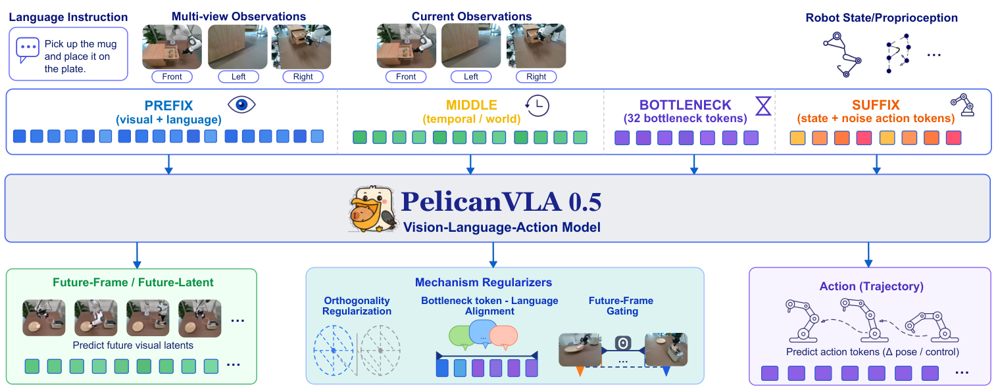

X-Humanoid, WFM System Group · July 2026

<h3><a href="https://arxiv.org/abs/2607.06655">Pelican-VLA 0.5: Attending Before Acting Benefits Generalization</a></h3>

Pelican-VLA Team · <strong>Yinda Chen</strong>, contributor

The VLA component of Pelican-Unified connects vision-language understanding, future-frame generation, and action prediction through learnable bottleneck tokens. The work studies task-relevant attention and manipulation generalization.

<a href="https://arxiv.org/abs/2607.06655">Report</a><a href="https://github.com/Open-X-Humanoid/Pelican-VLA05">Code</a><a href="https://huggingface.co/X-Humanoid/Pelican-VLA05">Models</a>

</article>

<article class="paper-box">

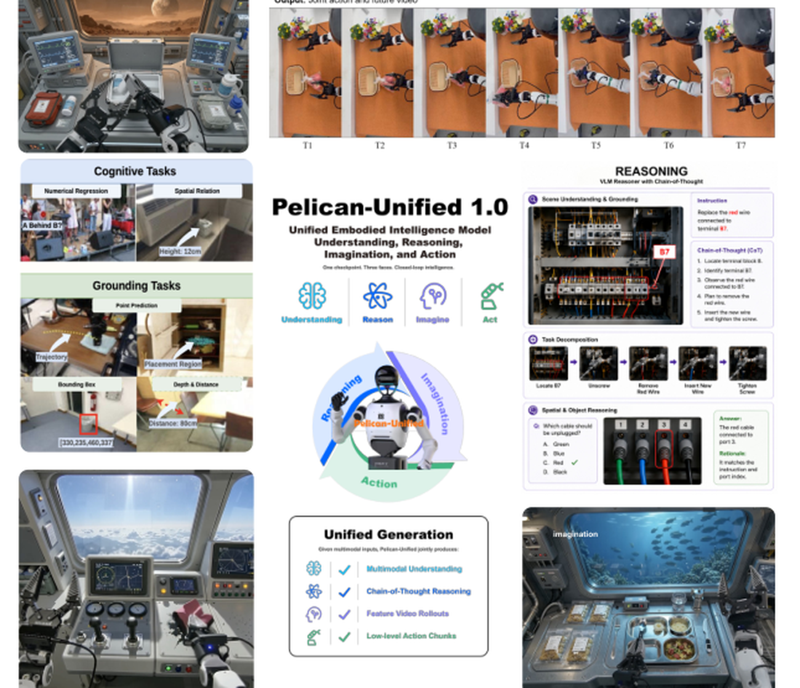

X-Humanoid, WFM System Group · May 2026

<h3><a href="https://arxiv.org/abs/2605.15153">Pelican-Unified 1.0: A Unified Embodied Intelligence Model (UEI) for Understanding, Reasoning, Imagination and Action</a></h3>

Pelican-Unified Team · <strong>Yinda Chen</strong>, core contributor

My contribution: unified vision-language modeling and action capability.

A unified embodied model that combines scene and instruction understanding, task reasoning, and joint prediction of future video and robot actions.

<a href="https://arxiv.org/abs/2605.15153">Report</a><a href="https://www.x-humanoid.com/">Organization</a>

</article>

